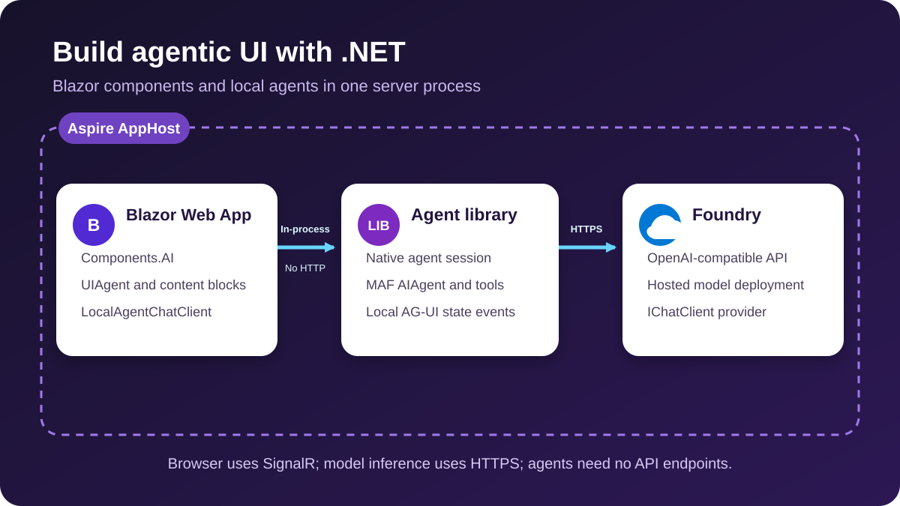

# Building agentic UI with .NET

This sample builds rich agentic experiences with **Blazor Interactive Server** and the preview [Blazor AI components](https://learn.microsoft.com/aspnet/core/release-notes/aspnetcore-11#experimental-blazor-ai-components-for-agentic-user-interfaces). **Microsoft Agent Framework (MAF)** agents run **in the Blazor server process**, using **Microsoft Foundry** for model inference. **Aspire** wires the model dependency directly to the web host.

There is no separate agent API or AG-UI HTTP/SSE transport. The sample retains **AG-UI state event types internally** for its existing typed state mappers. The browser still communicates with Blazor through SignalR, and inference still uses Foundry HTTPS.


## What it demonstrates

| Scenario | Behavior | Blazor page |
| --- | --- | --- |
| Agentic chat | Streaming, multi-turn chat with structured rich text | `/agentic-chat` |
| Backend tools | Server-executed weather function with generated typed blocks and a custom card | `/backend-tools` |
| Frontend tools | Page-owned function invoked in the originating Blazor circuit | `/frontend-tools` |
| Human in the loop | Native tool approval request, Approve/Reject, and resume | `/human-in-the-loop` |
| Shared state | Editable recipe state passed into the next run and projected from tool results | `/shared-state` |
| Predictive state | Proposed document edits with preview, acceptance, rejection, and rollback | `/predictive-state` |
| Agentic generative UI | Live plan progress through local state snapshots and JSON Patch deltas | `/agentic-generative-ui` |
| Reasoning | Provider-supplied reasoning content rendered in a custom activity block | `/reasoning` |

Workflow and selective-approval agents remain available in `AgentCatalog` without additional UI pages.

## Architecture



- **`AgenticUI.Web`** is the only application web host. Each page owns a `UIAgent` over a `LocalAgentChatClient`, created by the scoped `LocalAgentConnection`.
- **`AgenticUI.AgentServer`** retains its historical name but is now a **class library**, not an API executable. It contains the catalog, backend tools, serializer metadata, state-aware agents, and native chat adapter.
- **`LocalAgentChatClient`** binds an independent MAF session per client. The native `AsIChatClient` adapter handles messages, tool calls/results, frontend functions, and approvals. No extra function-invocation loop is added. Tool results also produce local `StateSnapshotEvent`/`StateDeltaEvent` values for the state mappers.
- **`AgenticUI.AppHost` / `AgenticUI.ServiceDefaults`** provide orchestration, health checks, and telemetry. AppHost references the existing Foundry resource and chat deployment directly from `web`.

Each `UIAgent` uses a `LocalConversationThread` that captures the native session's conversation ID and explicitly enables stateful history. Without that thread configuration, the preview UIAgent sends full history and would duplicate the native session's messages. With it, subsequent turns send only new messages. Reset creates a new client/session and thread. Conversations are in memory only; pages/circuits do not share messages, pending approvals, or UI callbacks. There is no durable store or recovery after server restart/circuit loss.

### Packages

- `Microsoft.Agents.AI.OpenAI`, `Microsoft.Agents.AI.Workflows` 1.24.0
- `AGUI.Abstractions` 1.0.0 (local event/request data only)
- `Azure.AI.OpenAI` 2.9.0-beta.1, `Azure.Identity` 1.21.0
- `Microsoft.AspNetCore.Components.AI` 0.1.0-preview.1.26459.102
- Aspire AppHost SDK 13.5.3 and `Aspire.Hosting.Foundry` 13.6.1-preview.1.26506.6

The Blazor components and native MAF `AsIChatClient` adapter are experimental. Package upgrades may require rechecking their integration contracts.

## Running

Use the .NET 11 RC1 SDK selected by `global.json`, the Aspire CLI, and Azure CLI. The developer identity must have access to the existing Foundry account and deployment (normally the **Cognitive Services OpenAI User** role).

```powershell
az login
dotnet build AgenticUI.slnx
aspire start --non-interactive
```

Open the **web** resource in the Aspire dashboard. The current AppHost contains the existing-account/deployment configuration; adjust those existing resource definitions for your account. This migration does not change or provision a different model resource.

For direct Web hosting without Aspire, supply the same active configuration that the deployment reference provides:

```powershell
$env:CHAT_URI = "https://<resource>.services.ai.azure.com/"
$env:CHAT_MODELNAME = "<deployment-name>"
dotnet run --project src\AgenticUI.Web
```

`CHAT_URI` must include the trailing slash: the existing model client appends `openai/v1/`. Authentication uses `DefaultAzureCredential` with the existing `https://ai.azure.com/.default` scope. No API keys are stored in source.

### Reasoning limitation

The active host preserves the existing Chat Completions model client for both ordinary and reasoning scenarios. The activity renderer accepts `TextReasoningContent`, but that client may not return reasoning summaries. The unused `Foundry.CreateReasoningChatClient` helper illustrates a Responses-based path; switching providers is outside this migration.

## Tests

```powershell
dotnet test tests\AgenticUI.Tests\AgenticUI.Tests.csproj
```

Tests use deterministic model streams and counted functions rather than live Foundry calls. They exercise the installed native adapter, tool/approval behavior, local state projection, conversation isolation, and cancellation.

## Repository layout

```text
src\
  AgenticUI.AppHost\          Aspire orchestration
  AgenticUI.ServiceDefaults\  Shared web host defaults
  AgenticUI.AgentServer\      In-process agent class library
  AgenticUI.Web\              Blazor Interactive Server host and UI
tests\
  AgenticUI.Tests\            Deterministic integration tests
docs\
  findings.md                Integration notes and limitations
```

See [integration findings](docs/findings.md) for state, tool, and rendering details.
